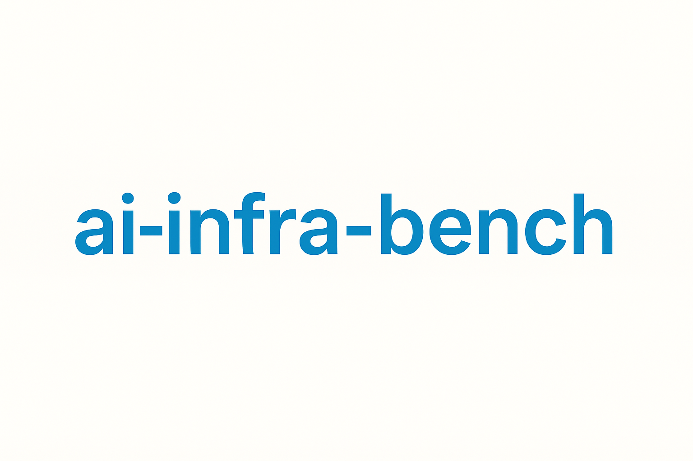

<div align="center">



[](LICENSE)
[](https://www.python.org/)
[](https://pypi.org/project/ai-infra-bench/)
[](https://muqi1029.github.io/ai-infra-bench/)

**[简体中文文档](https://muqi1029.github.io/ai-infra-bench/) · [English Docs](https://muqi1029.github.io/ai-infra-bench/en/)**

</div>

# AI Infra Bench (`aib`)

Zero-SDK CLI for benchmarking OpenAI-compatible LLM endpoints, searching SLO capacity limits, evaluating accuracy, and inspecting hardware.

## Install

```bash
pip install ai-infra-bench
pip install 'ai-infra-bench[data,weight]'  # optional datasets, tokenizers & safetensors audit
```

## Quickstart

```bash
# 1. Smoke test (also supports stdin `-` or piped JSON)
aib req --base-url http://127.0.0.1:30000 --model your-model --prompt "Who are you?"
cat request.json | aib req --payload-path - --model your-model

# 2. Throughput, latency percentiles & Goodput benchmark + HTML report
aib bench \
  --base-url http://127.0.0.1:30000 \
  --dataset random --input-len 1024 --output-len 256 \
  --num-requests 100 --max-concurrency 1 8 32 \
  --goodput ttft:500 tpot:50 --metric-path metrics.jsonl
aib plot-metrics metrics.jsonl -o metrics.html

# 3. SLO binary search, multi-turn session replay & evaluation
aib slo examples/slo.yaml -o slo-result.yaml
aib session-bench 'sessions/**/*.jsonl' --max-concurrency 16 --num-warmup-sessions 0
aib eval-dataset --evals gsm8k --base-url http://127.0.0.1:30000 --model your-model --num-questions 20
aib eval-logits --base-urls http://127.0.0.1:30000 http://127.0.0.1:30001 --model your-model
```

## Commands

| Command | Purpose |
| --- | --- |
| `req` | Send a single request (streaming, raw SSE, `--payload-path -` / `--prompt -`) |
| `bench` | Concurrent benchmark (`TTFT`, `ITL`, `TPOT`, throughput, `Goodput`, `--cache-ratio`) |
| `session-bench` | Concurrent multi-turn JSONL session replay |
| `slo` | YAML-driven binary search for max concurrency or request rate |
| `plot-metrics` | Export interactive Plotly HTML comparison charts |
| `eval-dataset` | Accuracy on `gsm8k`, `gpqa`, `aime25`, `hle`, `constrained_decoding`, `deepswe` |
| `eval-logits` / `eval-hidden-states` | Multi-endpoint Top-K logprobs and hidden-states numerical diff |
| `monitor` | Local Prometheus + Grafana live serving dashboard |
| `check-device` / `check-weight` | Stdlib-only GPU hardware check and safetensors parameter count |
| `token` / `profile-sgl` / `reply` | Tokenizer encode/decode, SGLang profiling, and token-ID replay export |

Full guides: **[简体中文](https://muqi1029.github.io/ai-infra-bench/)** · **[English](https://muqi1029.github.io/ai-infra-bench/en/)** · Local preview: [`website/README.md`](website/README.md)

## Development

```bash
python -m pip install -e .
pytest
```

Licensed under the [Apache License 2.0](LICENSE).
